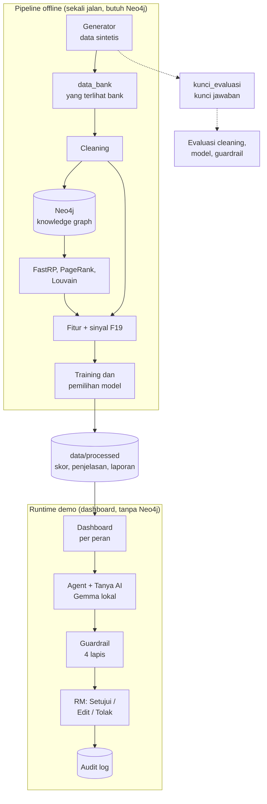
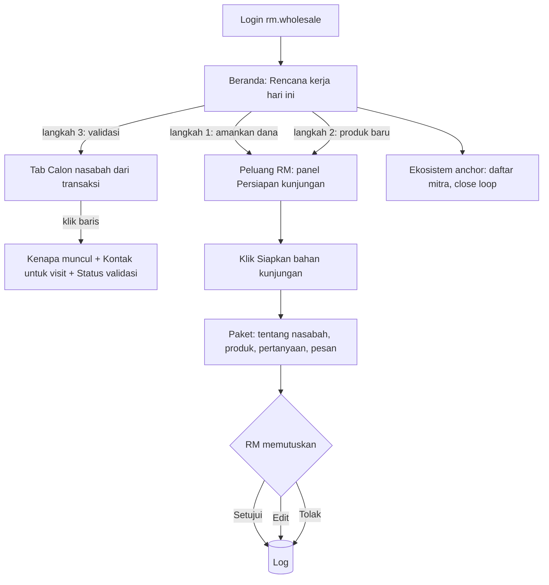
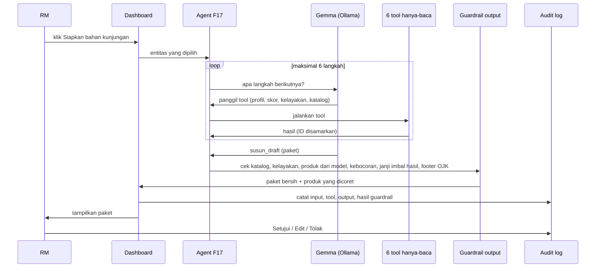
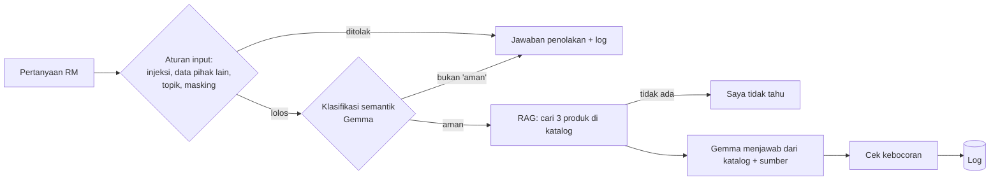
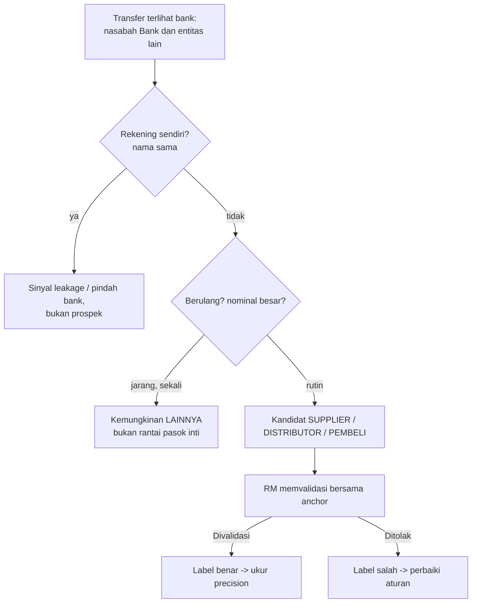

# Kamus Project RM Copilot

Semua yang perlu diketahui tentang project ini, untuk developer, pengguna (RM), bisnis, dan presenter: gambaran besar, diagram alur, kamus istilah, dan istilah yang sering tertukar. Bila bingung membaca dokumen lain, cari istilahnya di sini dulu.

## Daftar isi

1. Project ini dalam 5 kalimat
2. Diagram alur
3. Kamus: bisnis dan perbankan
4. Kamus: produk dan jalur transaksi Bank
5. Kamus: data
6. Kamus: graph
7. Kamus: machine learning dan metrik
8. Kamus: GenAI dan evaluasi AI
9. Kamus: guardrail dan regulasi
10. Kamus: aplikasi dan teknologi
11. Kamus: istilah project
12. Istilah yang sering tertukar
13. Siapa perlu tahu apa

---

## 1. Project ini dalam 5 kalimat

1. **Masalah:** calon nasabah Bank sudah terlihat di transaksi nasabah Bank sendiri (supplier, buyer, karyawan mereka), tetapi RM tidak punya cara melihat dan memprioritaskannya.
2. **Data:** karena tidak boleh memakai data nasabah sungguhan, kami membangkitkan data **sintetis** yang dikalibrasi ke data resmi Indonesia.
3. **Graph + ML:** hubungan antar nasabah dipetakan dalam **knowledge graph** (Neo4j), lalu model **machine learning** memberi skor: siapa yang paling mungkin menjadi nasabah, produk apa berikutnya, nasabah mana yang berisiko memindahkan dana.
4. **GenAI + guardrail:** model bahasa lokal (**Gemma**) menyiapkan bahan kunjungan hanya dari katalog Bank, lalu **guardrail** memeriksa keamanan dan kepatuhannya.
5. **Manusia memutuskan:** RM menyetujui, mengubah, atau menolak; semua tercatat di log.

---

## 2. Diagram alur

### 2.1 Gambaran besar: dari data sampai keputusan RM

Kotak atas adalah **pipeline offline**: dijalankan sekali dengan `python -m pipelines.run_offline`, butuh Neo4j, hasilnya disimpan ke `data/processed`. Kotak bawah adalah **runtime demo**: dashboard hanya membaca hasil itu, tidak butuh Neo4j. Garis putus-putus: kunci jawaban hanya dipakai untuk evaluasi, tidak pernah masuk model.

### 2.2 Alur kerja RM Wholesale

### 2.3 Apa yang terjadi saat tombol "Siapkan bahan kunjungan" diklik

Bila Gemma gagal atau mati, agent memakai **format standar** (template) dengan tool dan guardrail yang sama.

### 2.4 Alur pertanyaan Tanya AI

### 2.5 Walk-forward: bagaimana model diuji

```mermaid
gantt
    title Kalender 17 bulan data sintetis (akuisisi dan wholesale)
    dateFormat X
    axisFormat %s
    section Jendela train/validasi
    Fitur bulan 1-5      :a1, 1, 6
    Label bulan 6-11     :a2, 6, 12
    section Jendela test
    Fitur bulan 7-11     :b1, 7, 12
    Label bulan 12-17    :b2, 12, 18
```

Model belajar dari jendela lama, lalu diuji di jendela baru yang tidak pernah dilihat. Champion dipilih dari 25% data jendela lama yang disisihkan (**validasi**), bukan dari test.

### 2.6 Alur pertanyaan "apakah ini benar anggota value chain?"

---

## 3. Kamus: bisnis dan perbankan

| Istilah | Arti dalam project ini |
|---|---|
| **RM** (Relationship Manager) | Pegawai bank yang mengelola hubungan dengan nasabah dan mencari nasabah baru. Pengguna utama sistem. |
| **RM Retail** | RM untuk nasabah perorangan. Di sistem: akun `rm.retail`. |
| **RM Wholesale / Corporate / Transactional** | RM untuk nasabah perusahaan (segmen Commercial dan Corporate). RM yang diwawancarai adalah RM Transactional segmen Commercial. Akun `rm.wholesale`. |
| **Product Specialist (PS)** | Ahli produk yang diajak RM untuk produk kompleks (trade, L/C, garansi). |
| **Segmen** | Pengelompokan nasabah perusahaan: **UMKM** (kecil), **Commercial** (menengah, omzet sekitar Rp10–150 miliar menurut interview), **Corporate** (besar). |
| **Nasabah** | Pihak yang sudah punya rekening atau produk Bank. |
| **Prospek / calon nasabah** | Pihak yang belum menjadi nasabah Bank. |
| **NBO** (Next-Best-Offer) | Rekomendasi produk berikutnya yang paling cocok untuk nasabah lama. |
| **Cross-sell** | Menjual produk tambahan ke nasabah yang sudah ada. |
| **Akuisisi** | Mendapatkan nasabah baru. |
| **Value chain** (rantai nilai / rantai pasok) | Jaringan usaha di sekitar satu perusahaan: pemasoknya, distributornya, pembelinya, karyawannya. |
| **Anchor** | Perusahaan besar nasabah Bank yang menjadi pusat value chain. Mitranya adalah calon nasabah. 50 anchor di data. |
| **Anchor showcase** | Anchor yang dipilih otomatis untuk demo: **C000033** (PT Anchor 0033). |
| **Mitra** | Perusahaan yang bertransaksi dengan nasabah/anchor. |
| **Supplier** | Mitra yang **dibayar** oleh nasabah (nasabah membeli darinya). Di data: arah transaksi KELUAR. |
| **Buyer / pembeli** | Mitra yang **membayar** nasabah (membeli dari nasabah). Arah MASUK. |
| **Distributor** | Mitra yang menyalurkan produk anchor ke pasar. |
| **LAINNYA** | Mitra yang bertransaksi dengan anchor tetapi bukan rantai pasok inti, dan transaksinya jarang (rata-rata 1 kali per bulan; supplier 4, distributor 6). Contoh: jasa kebersihan, sewa gedung, pembelian peralatan sekali-sekali. |
| **Pedagang** | Perorangan yang membeli dari distributor/anchor Bank. Didekati lewat program anchor. |
| **Karyawan (prospek)** | Pegawai perusahaan nasabah yang belum nasabah Bank. Didekati lewat Payroll Korporasi. |
| **Counterpart / counterparty** | Lawan transaksi (pihak di ujung lain sebuah transfer). Dua kata ini dipakai bergantian. |
| **Lead** | Calon nasabah yang muncul dari data, belum divalidasi. |
| **Status validasi** | Tindak lanjut lead oleh RM: Baru, Divalidasi, Ditindaklanjuti, Ditolak. |
| **Close loop** | Porsi nilai transaksi nasabah dengan mitra yang **juga nasabah Bank**, sehingga uangnya tetap di Bank. Anchor showcase sekitar 18%. |
| **Leakage (dana)** | Dana nasabah mengalir ke rekeningnya sendiri di bank lain: tanda nasabah mulai pindah bank. |
| **Reaktivasi** | Mengaktifkan lagi produk yang pernah dipakai nasabah lalu berhenti (misalnya Garansi Bank). |
| **Debitur / non-debitur** | Nasabah yang punya fasilitas kredit / yang belum. |
| **KC** (Kantor Cabang) | Cabang Bank. Di data sintetis disederhanakan menjadi satu KC per provinsi. |
| **Kanwil** (Kantor Wilayah) | Kantor regional yang membawahi beberapa cabang. Pemetaan dari `kanwil.csv` dan `provinsi_kanwil.csv`. |
| **Kontak untuk visit** | Siapa yang dihubungi RM sebelum mengunjungi mitra: RM pengelolanya (bila sudah nasabah), RM di KC daerah mitra, atau Kanwil. |
| **CIF** (Customer Information File) | Nomor induk nasabah di sistem bank. |
| **TAP** (Tactical Account Plan) | Rencana kerja per nasabah yang disusun RM. Bahan TAP di sistem: volume transaksi per bulan dan close loop. |
| **CPR** (Customer Profitability Ratio) | Rasio profitabilitas nasabah. **Tidak dibuat** karena data pendapatan per nasabah tidak ada. |
| **CASA** (Current Account Saving Account) | Dana murah: giro + tabungan. |
| **NII / NIM** | Net Interest Income (pendapatan bunga bersih) / Net Interest Margin (NII dibagi aset produktif). |
| **NPL** (Non Performing Loan) | Kredit bermasalah. |
| **ECL** (Expected Credit Loss) | Perkiraan kerugian kredit yang dicadangkan bank. |
| **CIR** (Cost to Income Ratio) | Biaya operasional dibagi pendapatan. |
| **Spread** | Selisih bunga yang diterima bank dan biaya dananya. Spread kredit 4,5% di project = NII Bank dibagi total kredit (FY2025). |
| **Visit / kunjungan** | Pertemuan RM dengan nasabah atau calon nasabah. Paket persiapannya disebut H-1/H-2 (disiapkan 1–2 hari sebelum). |
| **Pitch** | Pesan penawaran untuk nasabah. Di sistem: bagian "4. Pesan untuk nasabah". |
| **Mis-selling (salah jual)** | Menawarkan produk ke orang yang tidak memenuhi syarat atau tidak membutuhkan. |
| **Business case** | Hitungan nilai bisnis program. Milik BA di `docs/Business/`. |
| **Payback** | Berapa lama biaya investasi kembali. |
| **Lift realization** | Asumsi BA: hanya sebagian kenaikan konversi di simulasi yang benar-benar terjadi di dunia nyata (40/60/80%). |

---

## 4. Kamus: produk dan jalur transaksi Bank

| Istilah | Arti |
|---|---|
| **Katalog produk Bank** | 216 baris produk dari situs resmi Bank (`produk_bank_knowledge.csv`), dasar RAG dan aturan kelayakan. |
| **Tabungan Plus / Tabungan Plus Bisnis / Tabungan Plus Muda / Tabungan Plus Anak** | Tabungan Bank untuk perorangan, usaha, anak muda, dan anak. |
| **Giro** | Rekening untuk transaksi usaha. |
| **Deposito** | Simpanan berjangka. |
| **Prioritas** | Layanan nasabah prioritas Bank. |
| **Mobile Banking** | Aplikasi mobile banking Bank. |
| **Kartu kredit (Visa Platinum, dll.)** | Wajib usia minimal 21 tahun (atau menikah) dan penghasilan minimal Rp3 juta per bulan (BI PADG 32/2025). |
| **Fleksi, KPR** | Kredit tanpa agunan untuk pegawai / KPR. |
| **Payroll / Payroll Korporasi** | Layanan pembayaran gaji karyawan perusahaan lewat Bank. |
| **CIB** | Internet banking untuk perusahaan (Cash, Receivables, Supply Chain). |
| **VA** (Virtual Account) | Nomor rekening virtual untuk menerima atau membayar tagihan banyak pihak. |
| **QRIS** | Quick Response Code Indonesian Standard: pembayaran dengan kode QR. |
| **EDC** | Electronic Data Capture: mesin pembayaran kartu di toko. |
| **KUR** (Kredit Usaha Rakyat) | Kredit bersubsidi untuk UMKM: Super Mikro, Mikro, Kecil. |
| **KMK / KI** | Kredit Modal Kerja / Kredit Investasi. Butuh usaha berjalan minimal 3 tahun (aturan di sistem). |
| **SCF** (Supply Chain Financing) | Pembiayaan untuk pemasok/distributor anchor berdasarkan tagihan ke anchor. |
| **L/C** (Letter of Credit) | Jaminan pembayaran untuk perdagangan, terutama impor/ekspor. |
| **SKBDN** | Surat Kredit Berdokumen Dalam Negeri: L/C untuk transaksi dalam negeri. |
| **SBLC** (Standby Letter of Credit) | Jaminan cadangan dari bank. |
| **Garansi Bank** | Jaminan bank untuk proyek (misalnya jaminan pelaksanaan kontraktor). |
| **Produk trade** | Kelompok L/C, SKBDN, SBLC, Garansi Bank. |
| **Reksa Dana, Bonds** | Produk investasi; wajib cek profil risiko dan SID sebelum ditawarkan. |
| **Pemindahbukuan** | Transfer antar rekening sesama Bank. Menandakan dana tetap di Bank (close loop). |
| **BI-FAST** | Transfer antarbank real-time dari Bank Indonesia, maksimal Rp250 juta per transaksi. |
| **SKN** (Sistem Kliring Nasional) | Transfer antarbank, maksimal Rp1 miliar per transaksi. |
| **RTGS** (Real Time Gross Settlement) | Transfer antarbank untuk nominal besar, di atas Rp100 juta. |
| **Jalur transaksi / channel** | Salah satu dari empat di atas. Volume per jalur ditampilkan di halaman Ekosistem. |

---

## 5. Kamus: data

| Istilah | Arti |
|---|---|
| **Data sintetis** | Data buatan program, bukan data nasabah sungguhan. Semua angka project ini dari data sintetis. |
| **Generator** | Program `synthetic_generator/run.py` yang membuat data sintetis. Satu perintah, hasil selalu sama. |
| **Seed** | Angka acak awal (42). Membuat hasil generator dan model bisa diulang persis. |
| **Kalibrasi data** | Menyesuaikan distribusi data sintetis dengan data resmi (BPS, OJK SNLIK, KSEI, AKKI, LPS, BI). |
| **ASUMSI / PROKSI** | Label angka: ASUMSI = dipilih tim karena tidak ada data publik; PROKSI = diturunkan dari data publik. |
| **data_bank** | Folder data yang realistis dilihat bank. Satu-satunya sumber fitur model. |
| **kunci_evaluasi** | Folder kunci jawaban (data lengkap yang tidak terlihat bank). Hanya untuk mengevaluasi, tidak pernah menjadi fitur. |
| **relationship_truth.csv** | Kunci jawaban jenis hubungan sebenarnya antar pihak: SUPPLIER, DISTRIBUTOR, PEMBELI, PAYROLL, OWNER, LAINNYA. |
| **kamus_data.csv** | Daftar setiap kolom: status (HIJAU–MERAH), sumber dunia nyatanya, dan boleh tidaknya dipakai model. |
| **Data kotor** | Masalah data yang sengaja ditanam: nilai hilang, variasi nama, outlier x1000, duplikat. Supaya cleaning dan EDA bisa diuji. |
| **Cleaning** | Membersihkan data kotor (`src/data/clean.py`). Hasilnya cocok 100% dengan kunci jawaban. |
| **Entity resolution** | Mencocokkan nama yang ditulis berbeda menjadi satu pihak (misalnya "PT MITRA 2423" = "PT Mitra 2423"). |
| **Missing struktural** | Nilai kosong yang memang wajar (bank tidak punya datanya), bukan kesalahan. |
| **EDA** (Exploratory Data Analysis) | Analisis awal untuk memahami data (`eda/interpretasi_eda.md`). |
| **Base rate** | Persentase kejadian positif bila memilih acak. Contoh: prospek perusahaan yang menjadi nasabah 4,1%. |
| **Label** | Jawaban yang ingin ditebak model, misalnya "menjadi nasabah dalam 6 bulan" (1/0). |
| **Fitur** | Informasi masukan model, misalnya nominal transaksi, jumlah mitra Bank. |
| **Jendela (window)** | Potongan waktu untuk fitur dan label (misalnya fitur bulan 1–5, label bulan 6–11). |
| **Walk-forward** | Melatih di jendela lama dan menguji di jendela berikutnya, meniru kondisi nyata. |
| **Lookback** | Berapa bulan ke belakang fitur dihitung (5 bulan, sama panjang di setiap jendela). |
| **Lookahead / kebocoran data** | Kesalahan memakai informasi masa depan untuk menebak masa lalu. Dicegah dan diuji di `tests/test_no_lookahead.py`. |
| **data/processed** | Hasil pipeline (skor, fitur, graph, penjelasan, cache AI). Dibagikan ke tim lewat zip, tidak lewat git. |
| **Golden set** | 50 kasus uji tetap untuk mengevaluasi AI (`tests/golden/llm_cases.jsonl`). |

---

## 6. Kamus: graph

| Istilah | Arti |
|---|---|
| **Knowledge graph** | Peta hubungan: titik (orang, perusahaan, produk, RM) dan garis (transfer, memegang produk, bekerja di, dikelola oleh). |
| **Node / simpul** | Titik dalam graph. Ada 94.461 node. |
| **Relasi / edge** | Garis antar node. Ada 973.369 relasi. |
| **Neo4j** | Database khusus graph. Versi 2026.09. Hanya dipakai di pipeline offline. |
| **GDS** (Graph Data Science) | Plugin Neo4j berisi algoritma graph. |
| **APOC** | Plugin Neo4j berisi prosedur bantu (dipakai untuk mengosongkan graph). |
| **Cypher** | Bahasa query Neo4j. |
| **Neo4j Browser** | Tampilan web Neo4j untuk melihat graph (`localhost:7474` di Docker). |
| **Embedding** | Deretan angka yang mewakili posisi sebuah node dalam jaringan. Node dengan hubungan mirip punya embedding mirip. |
| **FastRP** | Algoritma cepat pembuat embedding (64 angka per node). |
| **Kemiripan embedding** | Seberapa mirip posisi dua node di jaringan. Dipakai sebagai fitur (misalnya mirip dengan nasabah Bank). |
| **PageRank** | Ukuran seberapa sentral atau berpengaruh sebuah node di jaringan. |
| **Louvain / komunitas** | Algoritma yang mengelompokkan node menjadi klaster ekosistem. |
| **Dua langkah (two-hop)** | Mitra dari mitra. Misalnya rekan sesama pemasok anchor yang sudah nasabah Bank. |
| **Graph analytics** | Analisis memakai struktur jaringan; nilai tambah di rubrik capstone. |

---

## 7. Kamus: machine learning dan metrik

### Model

| Istilah | Arti |
|---|---|
| **Machine learning (ML)** | Program yang belajar pola dari data untuk menebak label. |
| **Baseline bisnis** | Cara kerja RM sekarang tanpa sistem, dijadikan pembanding (misalnya urutkan dari nominal terbesar). |
| **Logistic Regression (LR)** | Model sederhana dan mudah dijelaskan; sering menang di data dengan sinyal sedikit. |
| **Random Forest (RF)** | Kumpulan banyak pohon keputusan. |
| **XGBoost / LightGBM** | Model gradient boosting: pohon keputusan yang dibangun bertahap, saling memperbaiki. LightGBM adalah model utama. |
| **LightGBM tanpa graph / + graph** | Model yang sama tanpa dan dengan fitur graph. Dibandingkan untuk membuktikan nilai graph (ablation). |
| **Champion** | Model terbaik di validasi untuk satu mesin; yang dipakai sistem. |
| **Optuna / tuning** | Mencari pengaturan model terbaik secara otomatis (20–25 percobaan). |
| **Data tidak seimbang** | Kejadian positif jauh lebih sedikit dari negatif (NBO 0,2%). |
| **Class weights** | Memberi bobot lebih pada kelas langka saat melatih. |
| **Oversampling** | Menggandakan contoh kelas langka di data latih. Diuji berdampingan dengan class weights. |
| **SMOTE** | Membuat contoh sintetis kelas langka. **Tidak dipakai** karena titiknya tidak bermakna di ruang embedding graph. |
| **Negative sampling** | Mengambil sebagian contoh negatif saja (NBO 15%) supaya data latih tidak terlalu besar. |
| **Kalibrasi (isotonic)** | Menyesuaikan skor supaya bisa dibaca sebagai peluang sungguhan (skor 0,3 = sekitar 30% konversi). |
| **SHAP** | Cara menjelaskan kontribusi setiap fitur pada satu prediksi. Dasar kalimat "kenapa" di rekomendasi. |
| **Fairness** | Pemeriksaan apakah model memperlakukan kelompok (jenis kelamin, usia, provinsi) secara adil. |
| **Disparate impact** | Tingkat rekomendasi kelompok terendah dibagi tertinggi; diberi tanda bila di bawah 0,8. |
| **Equal opportunity** | Apakah pembeli sungguhan di setiap kelompok sama-sama ditemukan. |
| **Drift / PSI** | Pergeseran distribusi fitur antar waktu. PSI di atas 0,25 = drift besar. |
| **Nilai harapan** | Peluang × nilai rupiah produk − biaya kontak. Dasar ranking di halaman Profit. |

### Metrik

| Istilah | Arti sederhana | Cara membaca |
|---|---|---|
| **Precision** | Dari yang ditandai positif, berapa persen benar | Untuk RM: dari daftar yang dikunjungi, berapa yang konversi |
| **Recall** | Dari semua yang benar positif, berapa persen tertangkap | Berapa banyak peluang yang tidak terlewat |
| **F1** | Rata-rata harmonik precision dan recall | Satu angka keseimbangan keduanya |
| **Accuracy** | Persen tebakan benar | Menyesatkan untuk kelas langka (menebak "tidak" semua sudah 99%) |
| **ROC-AUC** | Peluang model menaruh positif di atas negatif (0,5 = acak, 1 = sempurna) | Untuk **membandingkan model**, bukan janji hasil |
| **PR-AUC** | Kualitas ranking yang fokus ke kelas langka | Dibandingkan dengan base rate; lebih jujur dari ROC-AUC untuk kejadian langka |
| **Precision@K / presisi daftar teratas** | Precision di K% teratas (10%; NBO 1%) | Metrik utama untuk kapasitas RM |
| **Lift desil 1** | Berapa kali lebih baik dari acak di 10% teratas | "3,4x" = 3,4 kali lebih banyak konversi dari memilih acak |
| **Hit@1 (NBO)** | Di antara nasabah yang benar-benar membeli, berapa persen produk pertama rekomendasi tepat | Bukan "persen rekomendasi yang dibeli" |
| **Recall@3 (NBO)** | Berapa persen pembelian tertangkap di 3 produk teratas | 93% di sistem |
| **Bootstrap** | Mengambil ulang sampel test ribuan kali untuk melihat seberapa stabil selisihnya | |
| **CI 95%** (selang kepercayaan) | Rentang di mana selisih sebenarnya kemungkinan besar berada | Bila rentangnya memuat 0, selisih **tidak signifikan** |
| **Signifikan** | Selisih kemungkinan besar bukan kebetulan | Prospek perusahaan: tidak signifikan |
| **Ablation** | Membandingkan model dengan dan tanpa satu komponen | Bukti graph membantu di 7 dari 9 mesin |
| **ECE** (Expected Calibration Error) | Rata-rata selisih peluang prediksi dan kenyataan | 0 = sempurna; sistem 0,006–0,041 |
| **Brier score** | Ukuran lain ketepatan peluang | Makin kecil makin baik |

---

## 8. Kamus: GenAI dan evaluasi AI

| Istilah | Arti |
|---|---|
| **GenAI / LLM** | Generative AI / Large Language Model: model yang menulis teks. |
| **Gemma 4 E4B** | LLM dari Google (`google/gemma-4-E4B-it`, lisensi Apache 2.0) yang dipakai sistem. Berjalan di laptop, gratis, data tidak keluar. |
| **Ollama** | Program yang menjalankan LLM di komputer sendiri (`localhost:11434`). |
| **Kuantisasi 4-bit** | Model dikompres supaya muat di GPU laptop 8 GB. |
| **Mode berpikir** | Fitur Gemma menulis "proses berpikir" dulu. Dimatikan supaya 2x lebih cepat. |
| **Temperature** | Tingkat keacakan jawaban (0,2 = konsisten). |
| **Prompt / system prompt** | Instruksi untuk LLM. System prompt = aturan tetap (hanya katalog, sertakan sumber, jangan tampilkan data pribadi). |
| **RAG** (Retrieval-Augmented Generation) | LLM menjawab berdasarkan dokumen yang dicari dulu (katalog Bank), bukan dari ingatannya. |
| **TF-IDF** | Cara mencari dokumen berdasarkan kata yang khas. Dipakai untuk mencari produk di katalog. |
| **Sitasi / sumber** | URL katalog yang wajib menyertai setiap produk yang disebut. |
| **Agent / agentic AI** | LLM yang merencanakan langkah dan memakai tool sendiri, lalu menyerahkan hasil untuk direview manusia. |
| **Tool / function calling** | Fungsi yang boleh dipanggil LLM (6 tool hanya-baca: ambil_profil, skor_produk, cek_kelayakan, cari_katalog, cek_compliance, susun_draft). |
| **F17 / F18 / F22** | Agent penyiap kunjungan / Tanya AI / paket persiapan kunjungan. |
| **Fallback / format standar** | Bila LLM gagal, sistem menyusun paket dari template dengan data dan guardrail yang sama (sekitar 9% kasus). |
| **Cache** | Jawaban LLM yang disimpan supaya klik berikutnya instan. |
| **warm_demo** | Perintah yang menyiapkan cache 19 entitas demo sebelum presentasi. |
| **Halusinasi** | LLM mengarang fakta. Dicegah dengan RAG, sitasi, cek katalog, dan aturan produk dari model. |
| **DeepEval** | Library untuk mengukur kualitas jawaban LLM dengan skor 0–1. |
| **LLM-as-judge / juri** | LLM lain yang menilai jawaban (`gpt-4.1-mini` dari OpenAI). Satu-satunya pemakaian kredit OpenAI. |
| **Faithfulness** | Jawaban sesuai konteks yang diberikan, tidak mengarang (100%). |
| **Answer relevancy** | Jawaban relevan dengan permintaan (100%). |
| **PII leakage** | Kebocoran data pribadi di pesan untuk nasabah (98% lolos). |
| **GEval** | Metrik dengan kriteria yang ditulis sendiri (kepatuhan pitch, alasan kontekstual). |
| **Tool correctness** | Apakah agent memanggil tool yang diharapkan (60%, mencerminkan fallback). |
| **Red team** | Menguji sistem dengan serangan sengaja (25 serangan dikenal, 6 serangan baru). |
| **Prompt injection** | Upaya menyuruh AI melanggar aturannya ("abaikan semua instruksi..."). |

---

## 9. Kamus: guardrail dan regulasi

| Istilah | Arti |
|---|---|
| **Guardrail** | Pagar pengaman di sekitar AI. Empat lapis: input, proses, output, audit. |
| **Masking** | Mengganti ID, nomor rekening, telepon, email dengan [ID], [NOMOR], [TELEPON], [EMAIL] sebelum ke LLM. |
| **Klasifikasi semantik** | Gemma menilai maksud pertanyaan (aman, injeksi, data pihak lain, di luar topik); menangkap parafrase yang lolos aturan. |
| **Kelayakan (eligibility)** | Syarat produk dari katalog dan regulator (usia, penghasilan, pekerjaan, segmen, umur usaha). |
| **Footer OJK** | Kalimat wajib di setiap penawaran: "Bank berizin dan diawasi oleh Otoritas Jasa Keuangan." |
| **Janji imbal hasil** | Kalimat seperti "pasti untung" atau "bebas risiko"; dihapus dari pesan untuk nasabah. |
| **Human-in-the-loop** | Manusia (RM) memutuskan setiap keluaran AI: Setujui, Edit, Tolak. |
| **Audit log** | Catatan setiap permintaan, langkah AI, hasil guardrail, model, versi prompt, dan keputusan RM (`outputs/audit.sqlite`). |
| **Versi prompt** | Kode pendek (hash) semua prompt, supaya setiap jawaban bisa dilacak ke versinya. |
| **OJK** | Otoritas Jasa Keuangan, pengawas bank. |
| **POJK 22/2023** | Peraturan OJK tentang perlindungan konsumen: tidak menyesatkan (Pasal 4), tidak memberi data ke pihak lain (22), syarat data pihak lain (23), pernyataan OJK di penawaran (35), aturan menawarkan lewat sarana pribadi (39). |
| **UU PDP** | UU 27/2022 Pelindungan Data Pribadi (dasar pemrosesan Pasal 20, transfer ke luar negeri Pasal 56). |
| **Rahasia bank** | Kewajiban bank merahasiakan data nasabah penyimpan dan simpanannya (UU Perbankan jo. UU P2SK). |
| **BI PADG 32/2025** | Aturan Bank Indonesia tentang kartu kredit (usia dan penghasilan minimal). |
| **DPO** | Data Protection Officer: penanggung jawab pelindungan data di perusahaan. |

---

## 10. Kamus: aplikasi dan teknologi

| Istilah | Arti |
|---|---|
| **Python 3.11** | Bahasa pemrograman seluruh project. |
| **.venv** | Lingkungan Python khusus project (library terpasang di sini). |
| **requirements.txt** | Daftar library dengan versi dikunci. |
| **pandas, numpy, scikit-learn** | Library olah data dan ML dasar. |
| **Streamlit** | Library untuk membuat dashboard web dengan Python. Versi 1.62. |
| **st.navigation** | Fitur Streamlit untuk menu berbeda per peran. |
| **Plotly** | Library grafik interaktif di dashboard. |
| **SQLite** | Database berbentuk satu file; dipakai untuk audit log. |
| **config/settings.yaml** | Pengaturan project: jendela waktu, path, Neo4j, LLM, akun demo. |
| **.env** | File rahasia (API key, password Neo4j). Tidak pernah di-commit atau dibagikan. |
| **Pipeline offline** | `python -m pipelines.run_offline`: clean, ingest, graph, features, models, explain, report. |
| **Docker** | Menjalankan aplikasi di dalam "kotak" yang sama di semua komputer. |
| **Image / container / volume** | Image = paket aplikasi; container = image yang sedang jalan; volume = penyimpanan yang tetap ada walau container dimatikan. |
| **docker compose** | Menjalankan beberapa container sekaligus (app, ollama, ollama-pull, neo4j) dengan `docker compose up -d app`. |
| **ngrok** | Program yang membuat link publik ke aplikasi di laptop, untuk uji pengguna dari luar. |
| **WebSocket** | Koneksi terus-menerus antara browser dan Streamlit. Bila diblokir (misalnya oleh kata sandi ngrok), halaman tampil putih. |
| **pytest** | Alat menjalankan tes otomatis (57 tes tanpa biaya API). |
| **Playwright** | Alat yang mengendalikan browser secara otomatis; dipakai menguji semua halaman per peran. |
| **git / commit / push** | Penyimpanan versi kode; push = mengirim ke GitHub. |
| **Mermaid** | Cara menulis diagram sebagai teks (dipakai di dokumen ini). |
| **archify** | Alat pembuat diagram arsitektur (`docs/arsitektur/`). |

---

## 11. Kamus: istilah project

| Istilah | Arti |
|---|---|
| **Capstone** | Proyek akhir program pelatihan data analytics. |
| **Juknis** | Petunjuk teknis capstone: rubrik dan bobot penilaian per hari. |
| **Hari 1–4** | Tahap penilaian capstone: problem statement, data dan baseline, advanced ML dan dashboard, presentasi dan live demo (15 Oktober 2026). |
| **PRD** | Product Requirements Document: dokumen kebutuhan produk (`docs/PRD.md`). |
| **Guideline Data Sintetis** | Aturan pembuatan data sintetis (`docs/Guideline_Data_Sintetis.md`). |
| **Grill me** | Sesi 30 pertanyaan untuk menguji dan mengunci keputusan PRD (`docs/Grill_Me_Keputusan.md`). |
| **F1–F26** | Kode fitur di PRD. Contoh: F17 agent, F19 sinyal transaksi, F21 Peluang RM, F23 dashboard per peran, F25 daftar mitra dan close loop. Jangan tertukar dengan metrik **F1 score**. |
| **Sinyal F19** | Tanda dari transaksi: counterpart baru (≥ Rp100 juta dalam 3 bulan), counterpart berulang (≥ 3 dari 6 bulan), transaksi besar, pindah bank, counterpart ganti bank. |
| **Mesin** | Satu model prediksi untuk satu pertanyaan (akuisisi, 4 label wholesale, NBO). |
| **Rencana kerja hari ini** | Bagian beranda RM berisi 3 langkah dengan tombol langsung. |
| **Beri masukan** | Tombol di sidebar untuk mencatat saran pengguna (`outputs/masukan_pengguna.csv`). |
| **Akun demo** | `rm.retail`, `rm.wholesale`, `manajemen`; password `demo123` (atau password sesi uji bila memakai link ngrok). |
| **Rekonsiliasi angka BA** | Perbandingan angka business case BA dengan angka terukur sistem (`docs/Rekonsiliasi_Angka_BA.md`). |

---

## 12. Istilah yang sering tertukar

| Ini | Bukan ini | Bedanya |
|---|---|---|
| **F1 score** (metrik) | **F1** (kode fitur PRD: pilih nasabah) | Konteks: angka 0–1 = metrik; "F" + nomor di tabel fitur = kode fitur |
| **Leakage dana** | **Kebocoran data (data leakage)** | Leakage dana = nasabah memindahkan uang ke bank lain. Kebocoran data = model memakai informasi masa depan atau kunci jawaban |
| **F1 / AUC model akuisisi** | **Ketepatan menentukan anggota value chain** | Model akuisisi menebak **siapa yang akan menjadi nasabah**. Keanggotaan value chain adalah syarat masuk daftar, diukur terpisah terhadap `relationship_truth.csv` |
| **Hit@1 71%** | **71% rekomendasi dibeli** | Hit@1 dihitung di antara nasabah yang memang membeli |
| **ROC-AUC tinggi** | **Model pasti bagus** | ROC-AUC bisa tinggi karena banyak negatif yang mudah; baca juga PR-AUC dan presisi teratas |
| **Validasi** | **Test** | Validasi untuk memilih model (dari data lama); test untuk melaporkan (data baru, tidak pernah disentuh) |
| **Baseline bisnis** | **Pilih acak** | Baseline = cara kerja RM sekarang; acak = base rate. Model harus mengalahkan baseline, bukan sekadar acak |
| **Close loop 18%** | **Porsi ke bank lain 82%** | Dua sisi dari angka yang sama (tanpa transfer ke rekening sendiri) |
| **Sudah Bank** | **Transaksinya lewat Bank** | Sudah Bank = terdaftar sebagai nasabah Bank; transaksinya bisa saja dari rekening di bank lain |
| **Counterpart** | **Counterparty** | Sama: lawan transaksi |
| **LAINNYA** | **Bukan mitra sama sekali** | LAINNYA tetap bertransaksi dengan anchor, hanya bukan rantai pasok inti dan jarang |
| **Mode cache** | **Jawaban lama yang salah** | Jawaban Gemma yang disimpan; dibuat ulang bila data atau model berubah |
| **Format standar (template)** | **Error** | Fallback yang disengaja bila Gemma tidak tersedia; guardrail tetap jalan |
| **Profit halaman Profit** | **Proyeksi BA Rp131 M** | Halaman Profit = per kampanye di sampel simulasi; BA = proyeksi skala program 3 tahun. Tidak dijumlahkan |
| **Pipeline offline** | **Dashboard** | Pipeline membangun data dan model (butuh Neo4j); dashboard hanya membaca hasilnya |

---

## 13. Siapa perlu tahu apa

| Peran | Wajib paham | Dokumen lanjutan |
|---|---|---|
| **Developer / Data Engineer** | Bagian 2.1, 2.5, 5, 6, 10 | `README.md`, `docs/Implementasi_Baseline_ML.md`, `docs/ringkasan_cleaning_data.md` |
| **Data Scientist / AI Engineer** | Bagian 7, 8, 9, 12 | `docs/Hasil_Model.md`, `docs/Implementasi_GenAI_RAG.md`, `docs/Implementasi_Guardrail.md`, `docs/Hasil_DeepEval.md` |
| **Business Analyst** | Bagian 3, 4, 7 (metrik), 12 (profit) | `docs/Asumsi_Business_Impact.md`, `docs/Rekonsiliasi_Angka_BA.md` |
| **Pengguna (RM)** | Bagian 2.2, 3, 4 | `docs/Panduan_Uji_Pengguna.md` |
| **Penguji dari luar** | Bagian 1 | `docs/Panduan_Uji_Pengguna.md` bagian 3 |
